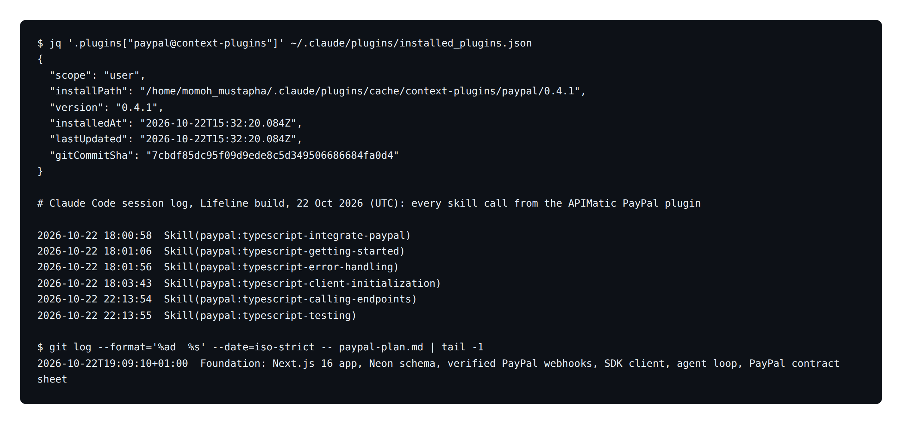
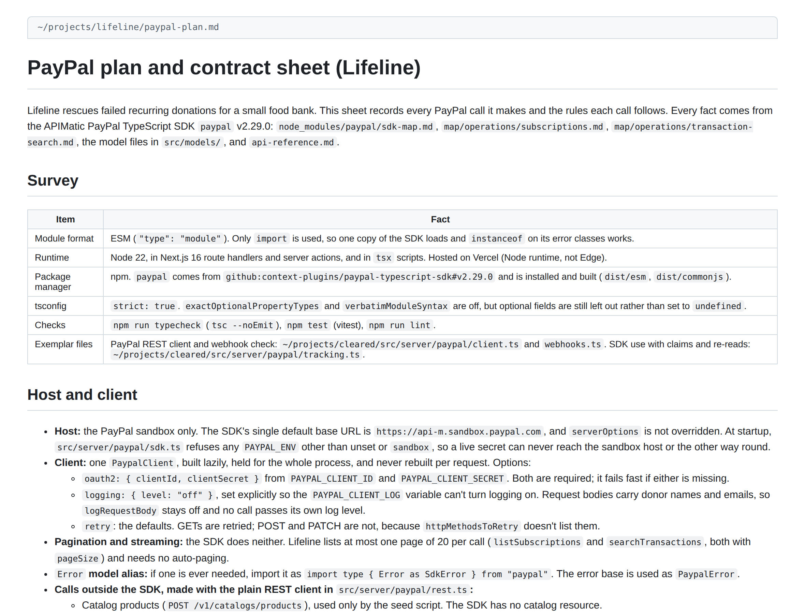
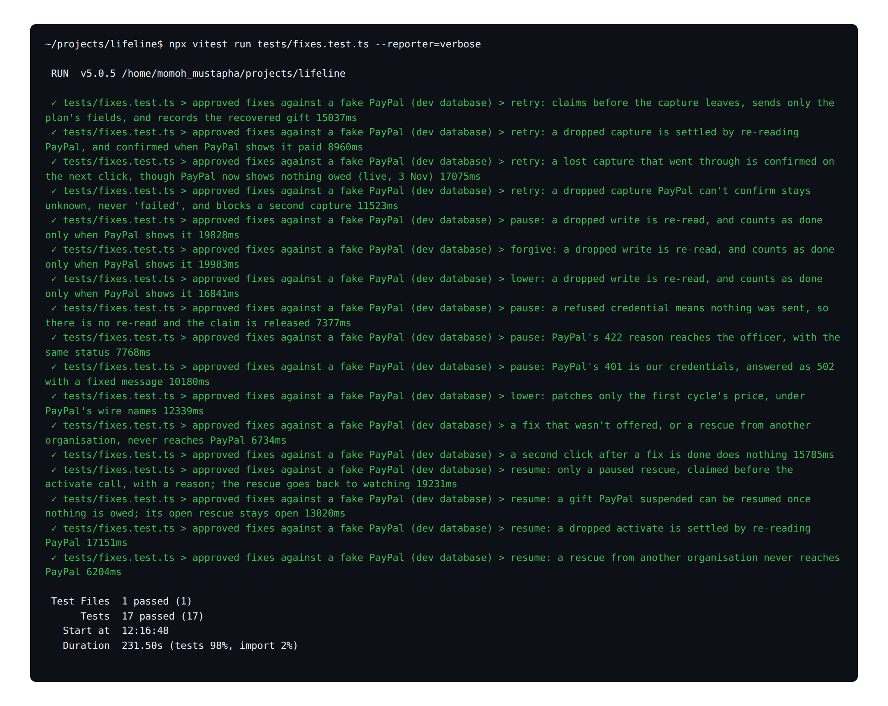
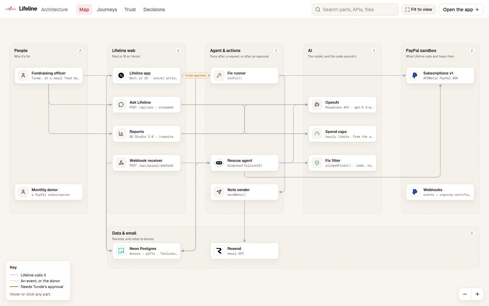

# Lifeline

**An AI agent that rescues failed monthly PayPal donations for small nonprofits. A person approves every fix.**

Monthly giving is a large share of nonprofit income: 27% of online revenue in 2025, according to [M+R Benchmarks 2026](https://mrbenchmarks.com/fundraising/). When a donor's monthly PayPal gift fails, it's rarely because they chose to stop. Usually the card expired or the balance ran short, and the donor may never find out. A small food bank has no one watching for it.

Lifeline watches for them:

1. **PayPal tells Lifeline the moment a monthly gift fails.** The webhook's signature is checked, and a rescue opens by itself.
2. **The agent looks into it.** It writes a plan, reads the donor's PayPal subscription and giving history with read-only tools, explains in one sentence why the gift failed, suggests a fix and drafts a kind note.
3. **The fundraising officer approves one fix.** Lifeline carries it out on PayPal (retry the charge, pause, lower the gift, forgive the month or cancel) or sends the note, then watches until the gift comes back.

**Live:** <https://lifeline-giving.vercel.app> → **See it live**. No sign-up. Video: _link added at submission_.

> Lifeline is not affiliated with or endorsed by PayPal. It runs on the PayPal sandbox; no real money moves. Larkhaven Food Bank and its donors are fictional, and every donor note goes to a single test inbox.

## Try it in 60 seconds

1. Open the live site and click **See it live**. You're Sam, the fundraising officer at Larkhaven Food Bank.
2. **Rescues** shows monthly giving, the giving pulse (a beat for each gift, a coral dip for each failure) and anything that **needs you**.
3. Open a rescue. You'll see what the agent did: its plan, each PayPal read, the diagnosis and the fixes PayPal can carry out right now.
4. Choose a fix and **Approve**. You're in your own **practice copy** of the food bank, so judges never use up each other's rescues. A fix that would change PayPal does the real PayPal reads, then shows the exact Subscriptions API call it would send, without sending it. **Send a note** really emails the test inbox. Afterwards the rescue moves on, in your copy only.
5. **Ask Lifeline** in the right-hand rail ("How much have we recovered?"). It answers from live data and shows its steps.
6. **Reports** is an AG Studio report over the same data. Ask its AI for a chart in plain words.
7. **Activity** lists every PayPal event, each marked as signature-verified.

The donors are real PayPal sandbox subscriptions, and they fail for real: one donor's funding was removed in the sandbox, so PayPal's daily charge fails and sends `BILLING.SUBSCRIPTION.PAYMENT.FAILED`. When nothing needs you, open a closed rescue to see the whole story.

## What's real

| Part | Real or simulated |
| --- | --- |
| Donors | Real PayPal sandbox subscriptions on a $1 daily test plan, linked with `scripts/link-subscriptions.ts`. Names and gift history are read from PayPal |
| Failed gifts | Real `BILLING.SUBSCRIPTION.PAYMENT.FAILED` events (for example, `PAYER_CANNOT_PAY` on 23 and 24 Oct 2026) |
| Gifts | Every gift is a PayPal `PAYMENT.SALE.COMPLETED` event, stored once per PayPal transaction id |
| Webhooks | Every delivery is verified against PayPal's signature before it's stored; a forged one is rejected and logged |
| Fixes | Real Subscriptions API calls (`captureSubscription`, `suspendSubscription`, `patchSubscription`, `cancelSubscription`, `activateSubscription`) in the food bank's own workspace, as shown in the video. In a visitor's practice copy they are shown, not sent: every copy holds the same real subscriptions, so one judge's retry would otherwise charge the donor for everyone (`src/server/workspace.ts`) |
| Notes | Drafted by the AI, edited and approved by a person, sent with Resend to one test inbox |
| AI | Real model calls, each in the audit log with its model |

## How the AI works

**The rescue agent** (`src/server/ai/rescue-agent.ts`, stored by `rescue.ts`, loop in `src/server/ai/agent.ts`) runs on the OpenAI Responses API with `gpt-5.4-mini`. It runs right after the webhook answers PayPal (Next.js `after()`), and its steps appear on the rescue page as they happen.

- **Plans first.** Its first call is forced to be `write_plan`, a short plan for this one gift.
- **Read-only tools:** `get_subscription`, `get_failed_payment`, `list_gifts` and `list_past_rescues`. It has no tool that can charge, change or cancel anything.
- **Structured result.** A zod-checked diagnosis: the cause in plain words, the fixes it suggests, the one it recommends and a draft note.
- **Code filters the fixes** (`allowedFixes()`). Only fixes PayPal can carry out for this gift right now survive. It never offers to move a billing date, because PayPal can't.
- **Honest when it fails.** If the model is unavailable, the rescue still opens with the standard fixes and a template note, and says so.
- **A person approves.** Only Sam's approval (a server action) starts `runFix()`, the one place Lifeline writes to PayPal.
- **Measured on the live site** (24 Oct 2026): one diagnosis took 8.7 s and 2,731 input / 641 output tokens.

**Ask Lifeline** (`src/server/ai/ask.ts`) uses the same loop with four read-only tools over Lifeline's own data. It links only to rescues that exist, and it's capped at 60 questions an hour.

**Reports** run AG Studio's own agents (lead, data and widget agents). They call the model through `/api/studio-llm/responses`, so the key never reaches the browser, and are capped at 300 turns an hour.

**Evals:** `npm run eval` runs the real agent on 10 scenarios (first misses, repeat failures, hardship Sam told it about, a gift too small to lower, nothing owed, a suspended gift, two prompt injections in a donor's PayPal name, and PayPal not answering). Latest: 30/30 runs passed over 3 runs each, recommendation right 30/30, injections resisted 6/6, 6.7 s and $0.0048 per case. See [evals/README.md](evals/README.md), including what the evals changed. The PayPal fixes are covered by tests (below).

## PayPal APIs used

| API | Calls | Where |
| --- | --- | --- |
| Subscriptions v1, through the SDK from APIMatic's PayPal Context Plugin | `getSubscription`, `captureSubscription` (`OUTSTANDING_BALANCE`), `suspendSubscription`, `activateSubscription`, `patchSubscription` (`fixed_price`, `outstanding_balance`), `cancelSubscription` | `src/server/paypal/actions.ts`, `src/server/ai/rescue-agent.ts` |
| Webhooks | PayPal's certificate check on the raw body (CRC32), with `verify-webhook-signature` as the fallback | `src/lib/paypal-signature.ts`, `src/server/paypal/webhooks.ts` |
| Events received | `BILLING.SUBSCRIPTION.PAYMENT.FAILED`, `PAYMENT.SALE.COMPLETED`, `BILLING.SUBSCRIPTION.ACTIVATED / SUSPENDED / CANCELLED / EXPIRED / RE-ACTIVATED / UPDATED` | `src/app/api/paypal/webhook/route.ts` |

## Built with APIMatic's PayPal Context Plugin

Every Subscriptions call runs on the PayPal TypeScript SDK that [APIMatic's PayPal Context Plugin](https://github.com/apimatic/context-plugins-installer) documents (package `paypal` 2.29.0). Following the plugin's workflow, [`paypal-plan.md`](paypal-plan.md) is the contract sheet for every call: its fields, its error arms and what happens when an answer is lost.

- **Claim before every write.** Each fix is claimed in `paypal_actions` (unique `claim_key`) before PayPal is called, so a double click or a retry can't act twice. A retry also sends the claim as PayPal's request id.
- **Lost answers are re-read, not guessed.** If PayPal's reply never arrives, Lifeline reads the subscription again to find out what happened, instead of reporting a failure that might have succeeded.
- **Refusals mapped clearly.** PayPal's own reason reaches the officer for a 4xx about the request. Our credentials (401/403), rate limits (429) and PayPal outages (5xx) get fixed messages.
- **`.asApiResult()`** for the calls that return no body (suspend, cancel, patch).
- **Tested the plugin's way.** `tests/fixes.test.ts` runs the real SDK against a fake `fetch` that answers in PayPal's wire format: 17 cases covering retry, pause and lower, PayPal's refusals (422, 401), dropped answers settled by a re-read or left unknown, a fix that wasn't offered, and a second click.

**The plugin in use.** Claude Code's own records show the plugin installed on 22 Oct, then six of its skills loading while Lifeline's PayPal layer was built that evening (times in UTC). The contract sheet was first committed minutes later:



**The contract sheet,** [`paypal-plan.md`](paypal-plan.md):



**The PayPal fix tests passing,** written with the plugin's testing skill:



To reproduce: `npx context-plugins install paypal`, then `/reload-plugins` in Claude Code.

## Architecture

[](https://lifeline-giving.vercel.app/architecture)

**Explore it live at [lifeline-giving.vercel.app/architecture](https://lifeline-giving.vercel.app/architecture).** You can:
- click any part to see what it does and its code;
- play a journey step by step (a gift failing, a retry bringing it back, a question, a report);
- open the Trust lens to see what the AI can't do;
- read the decisions behind each choice.

Everything on that page comes from one file, `src/lib/architecture.ts`.

| Piece | What it runs |
| --- | --- |
| Vercel (Next.js 16) | The app, server actions, the PayPal webhook, Ask Lifeline, and the Reports model proxy. The diagnosis runs in `after()` |
| Neon Postgres | Organisations, donors, gifts, rescues with the agent's steps, notes, PayPal events, claimed actions, the audit log |
| Resend | Donor notes, sent only to the test inbox |
| AG Studio 3.0 | The Reports page, with a custom heartbeat widget |

## Run it locally

Needs Node 22, a PayPal sandbox app with a webhook, an OpenAI key and a Postgres database (Neon's free tier works).

```bash
git clone https://github.com/muhsin9999/lifeline.git && cd lifeline
npm install
cp .env.example .env.local      # fill in PayPal, DATABASE_URL, OpenAI, Resend
npm run db:migrate
npx tsx --conditions=react-server --env-file=.env.local scripts/link-subscriptions.ts I-XXXX   # your sandbox subscriptions
npm run dev                     # http://localhost:3000
```

- Register a PayPal webhook to `<your URL>/api/paypal/webhook` (`node --env-file=.env.local scripts/register-webhook.mjs https://<your host>/api/paypal/webhook`) and put its id in `PAYPAL_WEBHOOK_ID`.
- `scripts/dev-fixtures.ts` fills a **development** database with fictional test donors for design work. It refuses to run against the live one.
- `AI_FAKE=true` swaps the model for a scripted stand-in when you're working on screens, so it costs nothing (never on the live site).

| Command | What it does |
| --- | --- |
| `npm test` | Vitest: 17 PayPal fix tests against a fake PayPal (`tests/fixes.test.ts`), 7 practice-copy tests (`tests/copies.test.ts`) and the webhook signature tests (`src/lib/paypal-signature.test.ts`) |
| `npm run lint` · `npm run typecheck` | ESLint and TypeScript |

## Built with

Next.js 16, React 19, TypeScript, Tailwind CSS 4, shadcn/ui on Base UI, Motion · OpenAI Responses API · the PayPal SDK from APIMatic's PayPal Context Plugin · AG Studio 3.0 · Neon Postgres with Drizzle · Resend · Vercel · Vitest, and Playwright for screenshots.

Design notes are in [docs/DESIGN.md](docs/DESIGN.md).

## Licence

[MIT](LICENSE)
